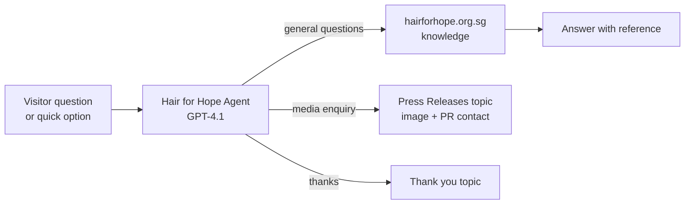

# Hair for Hope Virtual Assistant

## 1. Project Overview

The Hair for Hope Virtual Assistant is a conversational AI agent that answers questions about Hair for Hope, Singapore's head-shaving event in solidarity with children with cancer, organized by the Children's Cancer Foundation. It greets visitors with the event branding, offers quick-start options, and answers questions about childhood cancer, press and media contacts, and general enquiries in a warm, friendly tone.

* **Use case:** Answering public, participant, donor and media questions about a charity event
* **Intended audience:** Participants ("Shavees"), donors, volunteers, media and members of the public
* **Main technologies:** Microsoft Copilot Studio (agent "Hair for Hope Agent"), GPT-4.1 as the agent's model, the Hair for Hope website as a knowledge source, and custom topics with message and image nodes

## 2. Business Problem & Objectives

### Problem

Charity events receive many repeated questions: what the cause is about, how to take part or donate, and who to contact for media coverage. Answering these by email or phone takes volunteer and staff time, and visitors may not find the right page on the website quickly.

### Objectives

* Give visitors instant, friendly answers about Hair for Hope and the cause
* Guide users with clear starting options
* Ground answers in the official Hair for Hope website and show the source
* Route media and press enquiries to the right contact
* Reflect the warm, caring spirit of the event in every reply

## 3. Solution

The agent's description sets its role: supporting participants, donors, volunteers and the public with timely, accurate and friendly information, helping users register, donate, explore event details, access press resources and understand the cause. Its instructions also define a tone and style for responses.

When a conversation starts, the agent introduces itself ("Whether you're a Shavee, supporter, or just exploring, I'll guide you through your Hair for Hope journey with care and clarity"), shows the Hair for Hope logo and offers three quick options: **About Hair for Hope**, **Press Releases & Articles Topic** and **Contact and Help**.

### End-to-End Workflow

1. **Welcome:** The user sees the greeting, the event logo and the quick-start options.
2. **Ask about the cause:** The user asks "What is childhood cancer?" The agent explains what childhood cancer is, gives examples such as leukemia, brain tumors and lymphomas, links the answer to Hair for Hope's purpose, and cites www.hairforhope.org.sg.
3. **Ask a follow-up:** The user asks for the facts and myths about childhood cancer. The agent replies with two structured lists, for example "Myth: childhood cancer is contagious, it is not."
4. **Use a quick option:** Selecting **Press Releases & Articles Topic** runs a custom topic that shows a campaign image ("Hope is yours to give") and directs media coverage, interview and publicity requests to the PR team's email address.
5. **Close the conversation:** "Thank you for your information" triggers a **Thank you** topic, which replies "You're welcome."
6. **Give feedback:** The user rates the reply with a thumbs up and adds a comment ("nice!") in the "Tell us about your experience" box.

## 4. Solution Architecture & Technologies

| Component | Role |
|---|---|
| **Microsoft Copilot Studio** | Platform used to build and test the agent, its description, instructions, knowledge and topics |
| **GPT-4.1** | The agent's model for understanding questions and generating answers |
| **Knowledge source** (www.hairforhope.org.sg) | Grounds answers about the event and the cause, shown as a reference |
| **Custom topics** | "Press Releases & Articles" (image and message for media enquiries) and "Thank you" (closing reply), each triggered when the agent chooses based on the topic description |
| **Quick replies** | Starter options (About Hair for Hope, Press Releases & Articles Topic, Contact and Help) that guide users |

## 5. Controls & Validation

* **Grounded answers:** Answers about the cause cite the official Hair for Hope website
* **Defined scope and tone:** The description and instructions keep the agent focused on Hair for Hope topics, with a warm, caring style
* **Topic routing:** Topics are triggered by the agent from their descriptions (for example "thanks, thank you, thanks so much, ty"), so common requests get consistent, pre-approved replies
* **Fixed contact details:** Media enquiries always receive the same official PR contact from the Press Releases topic, rather than generated text
* **User feedback:** Each reply has thumbs up and thumbs down buttons, with an optional comment box
* **Testing before release:** The agent is tested in the "Test your agent" pane. The Analytics page shows it has not yet been published.

## 6. Business Value

* **Less load on staff and volunteers:** Common questions are answered automatically
* **Faster answers:** Visitors get information at any time, without searching the website
* **Accurate information:** Answers are grounded in the official site, with references
* **Consistency:** Media enquiries and closing messages always use the same approved wording
* **Better visitor experience:** Branded visuals, quick options and a caring tone match the spirit of the event

## 7. Skills Demonstrated

* Stakeholder analysis for a charity event (participants, donors, volunteers, media)
* AI agent design in Microsoft Copilot Studio
* Writing agent descriptions, instructions and tone guidelines
* Grounding an agent in a website knowledge source
* Building custom topics with message, image and trigger descriptions
* Conversation design with welcome messages and quick replies
* Testing agents and collecting user feedback

## 8. Future Enhancements

The following are **potential future enhancements**, not existing functionality:

* **Fix the instructions:** Correct "You are serves as the virtual assistant" to "You serve as the virtual assistant"
* **Registration and donation topics:** Add guided topics that link directly to the Shavee sign-up and donation pages
* **Event details:** Add dates, venues and FAQs as knowledge so the agent can answer logistics questions
* **Hand-off:** Offer a contact form or email route when the agent cannot answer
* **Publish and measure:** Publish the agent to the website and use Analytics to track engagement and satisfaction
* **Clarify affiliation:** As a portfolio project using a real charity's name, logo and imagery, add a note that it is a personal demonstration and not an official Children's Cancer Foundation service

---

## Final Summary

The Hair for Hope Virtual Assistant is a Copilot Studio AI agent, powered by GPT-4.1, that answers questions about Singapore's head-shaving event in solidarity with children with cancer. It welcomes visitors with branded visuals and quick options, answers questions about childhood cancer grounded in the official website, and routes media enquiries to the PR team through a custom topic. It gives supporters fast, friendly and consistent answers while reducing routine enquiries.
