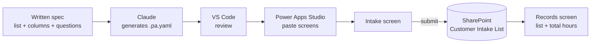

# Pedal Paradise Task Intake

**Vibe coding a Power Apps canvas app without a Premium licence**

## 1. Project Overview

Pedal Paradise Task Intake is a Power Apps canvas app that lets staff at Pedal Paradise, a cycling business, report tasks that slow the team down, so they can be reviewed for streamlining or automation. Each submission is saved to a SharePoint list, and a second screen shows all submitted tasks with a running total of hours spent each week. The app was "vibe coded": its two screens were generated as Power Apps YAML by an AI assistant from a plain-language description, then pasted into Power Apps Studio. It uses only SharePoint, a standard connector, so it runs without a Power Apps Premium licence.

* **Use case:** Collecting and reviewing time-consuming tasks as candidates for process improvement
* **Intended audience:** Pedal Paradise staff who submit tasks, and the person reviewing them for streamlining
* **Main technologies:** Power Apps (canvas app), SharePoint Online ("Customer Intake List"), Power Apps YAML (`.pa.yaml`) screen code, Visual Studio Code, and Claude (used to generate the YAML)
* **Licensing:** Standard connectors only (SharePoint), with no Premium connectors or Dataverse

## 2. Business Problem & Objectives

### Problem

Repetitive, time-consuming tasks are often known only to the people who do them. Without a simple way to report them, there is no shared list of where time goes each week, and it is hard to judge which tasks are worth streamlining or automating.

### Objectives

* Give staff a quick, structured way to describe a task and how long it takes
* Capture whether the task is repetitive and follows a logical process, which are key signs it could be automated
* Record the steps of the process when it does follow a clear pattern
* Store every submission in SharePoint
* Show all submissions and total weekly hours in one view
* Build the app quickly by describing it in plain language, and keep it within standard Microsoft 365 licensing

## 3. Solution

The app has two screens, reached through **New intake** and **View records** buttons at the top.

**Intake screen ("Pedal Paradise Task Intake")** asks four questions, with an optional fifth:

1. Description of task (required)
2. Hours spent on this task each week (required, numeric)
3. Is it repetitive? (required: Yes, No or Sometimes)
4. Does the process follow a logical process? (checkbox: "Yes, it follows clear, consistent steps")
5. Describe the repetitive process (required, appears only when question 4 is ticked)

**Records screen ("Pedal Paradise · Intake Records")** lists every submission with its weekly hours, repetitive and logical process answers, submission date and process description, and shows a summary line such as "3 records · 15 total hours per week". It also has a search box for descriptions.

### End-to-End Workflow

1. **Generate the screens:** A prompt describing the SharePoint list, its columns and the required questions is given to Claude, which produces YAML for the intake screen (`IntakeScreen.pa.yaml`) and the records screen (`RecordsScreen.pa.yaml`).
2. **Build the app:** The YAML is reviewed in Visual Studio Code and pasted into Power Apps Studio, creating the two screens in the "Pedal Paradise Task Intake" app.
3. **Submit a task:** In the demo, a staff member describes "Process cycling event registrations and send confirmation emails to riders", enters 8 hours a week, selects Yes for repetitive and ticks the logical process box.
4. **Describe the process:** The fifth question appears, and the user lists the steps (export registrations, check payment, assign bib number, update the participant list in Excel, send a confirmation email).
5. **Save:** The app shows "Submitting…" while saving, then "Thanks! Your intake has been submitted." and clears the form.
6. **Review:** The records screen now shows 3 records and 15 total hours per week, with the new task at the top.
7. **Confirm in SharePoint:** The **Customer Intake List** on the Pedal Paradise SharePoint site shows the new item with its Description, Weekly Hours, Repetitive, Logical Process and Repetitive Process Description values.

## 4. Solution Architecture & Technologies

| Component | Role |
|---|---|
| **Power Apps canvas app** | "Pedal Paradise Task Intake": the intake form and records screens |
| **SharePoint Online** ("Customer Intake List") | Stores each submission in typed columns (multi-line text, number, choice, yes/no). As a standard connector, it keeps the app free of Premium licensing |
| **Power Apps YAML** (`.pa.yaml`) | Code that defines each screen's layout, modern controls and formulas, pasted into Power Apps Studio |
| **Claude** | AI assistant used to generate the screen YAML from a written specification |
| **Visual Studio Code** | Used to review the generated YAML files before pasting them into the app |

## 5. Controls & Validation

* **Required fields:** The description, weekly hours, repetitive answer and (when shown) process description are marked with an asterisk as required
* **Typed inputs:** Weekly hours uses a number field, and "Is it repetitive?" uses a fixed list of Yes, No and Sometimes
* **Conditional logic:** The process description question appears only when the user confirms the task follows a logical process
* **Submission feedback:** The Submit button shows "Submitting…" and is disabled while saving, then a success message confirms the save and the form clears
* **Data written to typed columns:** Each answer is saved to the matching SharePoint column, as shown in the Customer Intake List
* **Up-to-date records:** The records screen refreshes the SharePoint list when it opens (`Refresh('Customer Intake List')` in its `OnVisible` property)

## 6. Business Value

* **Better visibility:** Everyone can see which tasks take time and how many hours they add up to each week
* **Better prioritization:** Repetitive, rule-based tasks with a clear process are easy to spot as automation candidates
* **Consistency:** Every task is reported with the same questions and stored in the same format
* **Less manual collection:** Task information goes straight into SharePoint, with no spreadsheets or emails to gather
* **Faster app building:** Vibe coding the screens as YAML from a written spec speeds up building a modern, styled interface
* **Lower cost:** Using SharePoint as the data source means the app needs no Power Apps Premium licence, so it can be rolled out to staff with standard Microsoft 365 licences

## 7. Skills Demonstrated

* Process improvement analysis (identifying automation candidates)
* Power Apps canvas app design with modern controls
* Writing and using Power Apps YAML (`.pa.yaml`) screen definitions
* Vibe coding: AI-assisted development that turns a plain-language specification into working app code
* Licence-aware solution design using standard connectors (SharePoint) instead of Premium ones
* SharePoint list design with typed columns
* Form design with required fields, conditional questions and submission feedback
* Summary reporting with record counts and totals

## 8. Future Enhancements

The following are **potential future enhancements**, not existing functionality:

* **Rename the list:** The list is called "Customer Intake List" but holds internal task submissions, so a name like "Task Intake" would be clearer
* **Capture the submitter and department:** Record who submitted each task, which helps follow-up and reporting
* **Scoring:** Add a simple automation score based on hours, repetitiveness and logical process, and sort the records by it
* **Review status:** Add a status (New, Under Review, Approved, Automated) so reviewers can track each idea
* **Notifications:** Use Power Automate to alert the reviewer when a new task is submitted
* **Publish the app:** Publish it and add it to the Pedal Paradise SharePoint site so staff can use it outside the studio

## Summary

Pedal Paradise Task Intake is a Power Apps canvas app that helps a cycling business find tasks worth streamlining. Staff describe a task, its weekly hours, whether it is repetitive and, if it follows clear steps, the process itself. Submissions are saved to a SharePoint list and shown on a records screen with total weekly hours. Vibe coded from YAML generated with Claude, and built on SharePoint, it runs without a Power Apps Premium licence.
