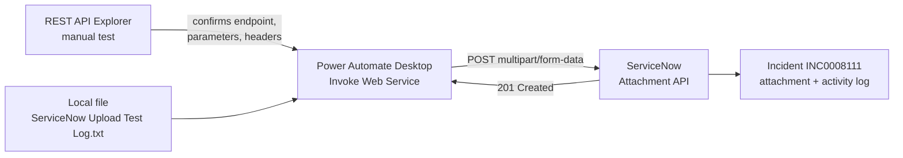

# ServiceNow REST API Integration: Automated Attachment Upload

## 1. Project Overview

This project uploads a file as an attachment to a ServiceNow incident record automatically, by calling ServiceNow's Attachment REST API instead of using the ServiceNow user interface. The API is first tested manually in ServiceNow's REST API Explorer, then the same call is automated in a Power Automate Desktop flow named "ServiceNow Upload Attachment".

* **Use case:** Attaching supporting files, such as logs, test reports or documentation, to ServiceNow incidents without manual uploads
* **Intended audience:** IT service management and automation teams who work with ServiceNow records
* **Main technologies:** ServiceNow Attachment API (`/api/now/attachment/file`), ServiceNow REST API Explorer, and Microsoft Power Automate Desktop (Invoke Web Service action)

## 2. Business Problem & Objectives

### Problem

Attaching a file to a ServiceNow record is normally a manual task: someone opens the record, finds the attachment option, browses for the file and uploads it. When this has to happen repeatedly, for example whenever another process produces a new log or output file, manual attachment does not scale and is easy to forget or delay.

### Current Process

A user opens the incident in ServiceNow and adds the file through the record's attachment option by hand.

### Objectives

* Confirm that the Attachment API accepts a file upload against a specific table and record, with the correct parameters and authentication
* Build a flow that uploads a file to an incident with no manual interaction with the ServiceNow interface
* Verify that an automated upload produces the same result on the record as a manual one

## 3. Solution

The integration uses a POST request to ServiceNow's Attachment API (`/api/now/attachment/file`). The target table, the record's `sys_id` and the file name are passed as query parameters, and the request uses a `multipart/form-data` content type with an authenticated user token.

### End-to-End Workflow

1. **Test the API manually:** In the REST API Explorer, the "Upload an attachment from a binary request" operation is configured with `table_name=incident`, the incident's `table_sys_id` and a `file_name`, and a file is sent in the request body. ServiceNow returns **201 Created** with the uploaded file's metadata.
2. **Check the manual result:** Incident INC0008111 is opened to confirm the file appears under "Manage Attachments" with a timestamped activity log entry.
3. **Configure the flow:** In Power Automate Desktop, an Invoke Web Service action is set up with the same endpoint, parameters and POST method, with file upload enabled and a local file (`ServiceNow Upload Test Log.txt`) selected as the attachment.
4. **Run the flow:** The action returns a `StatusCode` of 201 and the raw web service response.
5. **Check the automated result:** The incident is refreshed and shows the new attachment ("ServiceNow Upload Test Log.txt", 644 bytes) next to the earlier manual uploads, with a matching activity log entry at the time the flow ran.

## 4. Solution Architecture & Technologies

| Component | Role |
|---|---|
| **ServiceNow REST API Explorer** | Used to inspect and manually test the Attachment API before automating it |
| **ServiceNow Attachment API** (`/api/now/attachment/file`) | The integration point that accepts a file upload for a given table and record |
| **ServiceNow Incident record** (INC0008111) | The target record where the attachment is uploaded and verified |
| **Microsoft Power Automate Desktop** | Builds and runs the "ServiceNow Upload Attachment" flow |
| **Invoke Web Service action** | Calls the API with the endpoint, query parameters, POST method, multipart file upload and user token, without a browser |

## 5. Controls & Validation

* **Test before automating:** The API call is proven manually in the REST API Explorer first, so the flow reuses a known-good endpoint, parameter set and header configuration
* **Explicit record targeting:** The table name and the record's `sys_id` are passed as parameters, so the file is attached to one specific incident
* **Authenticated requests:** The call uses an authenticated user token
* **Response check:** Success is confirmed by the 201 status code returned to the flow
* **Outcome verification:** After each run, manual and automated, the incident record is checked for the attachment and its activity log entry, not just for a successful API response

## 6. Business Value

* **Less manual work:** Files are attached without opening ServiceNow or uploading by hand
* **Reliability:** Testing the API first and checking the record afterwards gives confidence the integration works as intended
* **Consistency:** Every automated upload follows the same endpoint, parameters and format
* **Traceability:** Each upload appears in the incident's attachment list and activity log
* **Reusable pattern:** The same approach can attach generated files to ServiceNow records as part of larger automations

## 7. Skills Demonstrated

* ServiceNow REST API testing with the REST API Explorer
* REST API integration (POST requests, query parameters, multipart file upload, authentication)
* Desktop automation with Power Automate Desktop
* Configuring the Invoke Web Service action
* Reading HTTP status codes and API responses
* End-to-end verification of an integration in the target system

## 8. Future Enhancements

The following are **potential future enhancements**, not existing functionality:

* **Dynamic inputs:** Take the incident number, file path and file name as inputs instead of fixed values, and look up the `sys_id` from the incident number
* **Error handling:** Check for status codes other than 201 and log or alert on failures
* **Secure credentials:** Store the authentication token in a secure credential store rather than in the flow
* **Batch uploads:** Attach every file in a folder, or files produced by another process, in one run
* **Trigger from other flows:** Call this flow at the end of other automations so their output files are attached automatically

## Summary

This project integrates Power Automate Desktop with ServiceNow's Attachment REST API to upload files to incident records automatically. The API is first tested in ServiceNow's REST API Explorer, then the same call is automated with an Invoke Web Service action that returns a 201 Created response. The attachment and its activity log entry are verified on the incident, replacing manual uploads with a consistent, traceable and reusable integration.
